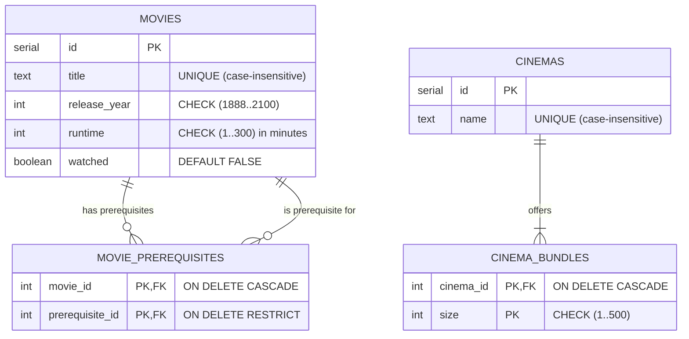

# Doomsday Ready

> **Assessment Submission:** Blinto Talent Accelerator 2027 &mdash; Full Stack Intern Assessment  
> **Application:** MCU Rewatch Planner (Graph Topological Sort) & Opening-Night Ticket Bundler (Dynamic Programming)

---

## 1. Project Overview

**Doomsday Ready** is a full-stack application built to solve two core challenges for Marvel fans preparing for *Avengers: Doomsday*:
1. **MCU Rewatch Planner (Graph Problem)**: Given a target movie with direct and transitive prerequisites, compute the optimal viewing order where every prerequisite is watched before the movies that depend on it. Includes cycle detection to strictly reject circular dependencies (`409 CIRCULAR_DEPENDENCY`).
2. **Opening-Night Bundle Booking (Coin-Change DP Problem)**: Given a cinema selling seats in fixed bundle sizes (e.g. 2, 5 seats) and a group size (1 to 10,000), compute the **minimum** number of exact seat bundles needed, or clearly determine if exact seating is impossible.

### Strict Hard Rules Met
- **Zero Forbidden Libraries**: All cycle detection, topological sorting, and coin-change dynamic programming algorithms were written from scratch as pure functions in `backend/src/algorithms/`. No `graphlib`, `toposort`, `dagre`, or coin-change packages.
- **Pure Algorithm Functions**: The algorithm modules have zero database or Express dependencies.
- **Strict Separation of Concerns**: Monorepo split into separate `backend/` and `frontend/` roots. Frontend interacts with the backend strictly through `/api/*`.
- **Swagger / OpenAPI Documentation**: Complete OpenAPI 3.0.3 specification hand-crafted at `backend/src/docs/openapi.yaml`, served live at `/api/docs`.
- **Standardized Error Envelope**: Every error conforms to `{ "error": { "code": string, "message": string } }`.

---

## 2. Data Model (Entity-Relationship Diagram)



---

## 3. Algorithmic Design & Purity

### Feature 1: Cycle Detection & Rewatch Order (`backend/src/algorithms/`)
- **Cycle Detection (`cycle.ts`)**:
  - `wouldCreateCycle(movieId, newPrereqIds, getPrerequisites)`:
  - Immediate check: returns `true` if `movieId` is in `newPrereqIds` (direct self-dependency).
  - Reachability traversal (DFS): traverses prerequisite edges starting from each new prerequisite. If `movieId` is reachable, a cycle would be created.
- **Topological Rewatch Order (`rewatchOrder.ts`)**:
  - Implements post-order DFS traversal with a `visited` set to ensure diamond dependencies (e.g. *Iron Man* required by both *The Avengers* and *Civil War*) are included exactly once.
  - A movie is appended to the order only after all its prerequisites have been visited.
  - The target movie itself is excluded.
  - Computes `watchedCount` and `remainingRuntime` (sum of runtimes of unwatched movies in the list).

### Feature 2: Minimum Exact Seat Bundles (`backend/src/algorithms/booking.ts`)
- **Dynamic Programming Model (Unbounded Knapsack / Coin Change)**:
  - State: `dp[i]` = minimum count of bundles whose sizes sum exactly to `i`. Initialized to infinity with `dp[0] = 0`.
  - `choice[i]` records the bundle size chosen that minimizes `dp[i]`.
  - For $i$ from 1 to `groupSize`:
    - For each bundle size $s$: if $i \ge s$ and $dp[i - s] + 1 < dp[i]$, update $dp[i] = dp[i - s] + 1$ and $choice[i] = s$.
  - If $dp[\text{groupSize}] = \infty$, returns `{ possible: false }` immediately (avoids infinite loops).
  - Backtracks through `choice` to reconstruct bundle frequencies, returned sorted by bundle size descending.
- **Why Greedy Fails (Proven in Test Suite)**:
  - Cinema bundles `[1, 3, 4]` for a group of 6:
    - Greedy chooses $4 + 1 + 1$ = **3 bundles**.
    - Optimal DP chooses $3 + 3$ = **2 bundles**.
- **Performance**: High-performance typed 32-bit arrays (`Uint32Array`) allow solving `groupSize = 10,000` with 10 bundle sizes in **~15ms** (< 100ms benchmark).

---

## 4. API Reference & Swagger UI

Interactive Swagger UI documentation is available at:  
👉 **[http://localhost:4000/api/docs](http://localhost:4000/api/docs)** (or via the frontend proxy at `http://localhost:5173/api/docs`).  
Raw OpenAPI 3.0 JSON is served at `http://localhost:4000/api/openapi.json`.

| Method | Path | Description | Success | Errors |
|---|---|---|---|---|
| `GET` | `/api/health` | Health check endpoint | `200` | &mdash; |
| `POST` | `/api/movies` | Register new movie with optional prerequisites | `201` | `400 VALIDATION_ERROR`, `400 INVALID_PREREQUISITE`, `409 DUPLICATE_TITLE`, `409 CIRCULAR_DEPENDENCY` |
| `GET` | `/api/movies` | List all movies with their prerequisites | `200` | &mdash; |
| `PATCH` | `/api/movies/:id` | Update movie attributes or replace prerequisites | `200` | `400 VALIDATION_ERROR`, `400 INVALID_PREREQUISITE`, `404 NOT_FOUND`, `409 DUPLICATE_TITLE`, `409 CIRCULAR_DEPENDENCY` |
| `GET` | `/api/movies/:id/rewatch-order` | Calculate MCU topological order and watch time | `200` | `404 NOT_FOUND` |
| `POST` | `/api/cinemas` | Register cinema with 1–10 distinct bundle sizes | `201` | `400 VALIDATION_ERROR`, `409 DUPLICATE_NAME` |
| `GET` | `/api/cinemas` | List all cinemas with their bundle sizes | `200` | &mdash; |
| `GET` | `/api/cinemas/:id/booking?groupSize=X` | Calculate fewest bundles quote for group size | `200` | `400 VALIDATION_ERROR`, `404 NOT_FOUND` |

### Standard Error Format
```json
{
  "error": {
    "code": "CIRCULAR_DEPENDENCY",
    "message": "Setting this prerequisite would create a cyclic dependency"
  }
}
```

---

## 5. Decisions and Assumptions (from `docs/DECISIONS.md`)

1. **No Authentication or Roles**: All endpoints are public; `watched` is a global flag on each movie.
2. **Quotes Only**: Booking returns a quote only; no reservation or payment state is persisted.
3. **Single Movie Creation**: `POST /movies` accepts one movie per request; prerequisites are referenced by ID.
4. **Full Prerequisite Replacement**: `PATCH /movies/:id` replaces the entire prerequisite array if `prerequisites` is provided.
5. **Case-Insensitive Uniqueness**: Duplicate movie titles or cinema names (checked via `LOWER()`) return `409 DUPLICATE_TITLE` / `409 DUPLICATE_NAME`.
6. **Unknown Prerequisite IDs**: Passing an unknown prerequisite ID returns `400 INVALID_PREREQUISITE`. Duplicate IDs in a list return `400 VALIDATION_ERROR`.
7. **Bundle Size Constraints**: 1 to 10 distinct integers, each between 1 and 500; duplicates return `400 VALIDATION_ERROR`. Stored sorted ascending in DB.
8. **Release Year Limits**: Validated between 1888 and 2100.
9. **Tie-Breaking in Bundles**: When multiple optimal combinations exist, any one is returned (sorted by size descending).
10. **Deterministic Topological Order**: Child edges are traversed in sorted order so identical graphs always produce identical orders.
11. **Group Size Bounds**: `groupSize` must be an integer between 1 and 10,000.
12. **Seed Data**: Populated with the 8 assessment MCU sample movies and 4 cinemas.
13. **Frontend Standards**: Built with Vite + React + Tailwind CSS, responsive across mobile, tablet, and desktop breakpoints.

---

## 6. How to Run

### Option A: One-Command Setup with Docker Compose (Recommended)

Make sure Docker and Docker Compose are installed and running:

```bash
docker compose up --build
```

- **Frontend Web App**: [http://localhost:5173](http://localhost:5173) (also available on port 80: `http://localhost`)
- **Backend API**: [http://localhost:4000/api](http://localhost:4000/api)
- **Swagger Documentation**: [http://localhost:4000/api/docs](http://localhost:4000/api/docs)
- The database is automatically migrated and seeded on startup (`SEED_DATA=true`).

---

### Option B: Local Development Setup

#### Prerequisites
- Node.js $\ge$ 20.x
- pnpm $\ge$ 10.x
- PostgreSQL 16 running locally on port 5432 (default db: `doomsday`)

#### 1. Backend Setup
```bash
cd backend
pnpm install
cp .env.example .env
pnpm migrate
pnpm seed
pnpm dev
```
Backend starts on [http://localhost:4000](http://localhost:4000).

#### 2. Frontend Setup
```bash
cd frontend
pnpm install
pnpm dev
```
Frontend starts on [http://localhost:5173](http://localhost:5173).

---

## 7. Testing & Quality Verification

Run the complete test suite and quality audits with the following commands:

```bash
# 1. Run all 46 backend unit & integration tests
cd backend
pnpm test

# 2. Verify backend strict TypeScript compilation
pnpm tsc --noEmit

# 3. Verify frontend strict TypeScript compilation and production build
cd ../frontend
pnpm tsc --noEmit
pnpm run build

# 4. Verify ZERO forbidden graph/DP libraries in algorithms
cd ..
git grep -rniE "graphlib|toposort|dagre|js-graph|coin-change" backend/src/algorithms
```

---

## 8. AI Usage Disclosure (from `docs/AI_USAGE.md`)

In full transparency according to the assessment rules:

| Task | What AI Did | What Human Reviewed & Directed |
|---|---|---|
| **1. Repository & Guidelines** | Initialized repository, created `.gitignore`, configured `AGENTS.md` and custom skills (`frontend-ui-standards`, `spec-driven-task`, `algorithm-tdd`, `swagger-api-docs`, `validate-and-report`, `conventional-commit`). | Reviewed repository structure, `.gitignore` rules, skills index, approved Task 1 spec. |
| **2. Specs & Architecture** | Refined [docs/PLAN.md](docs/PLAN.md) with 5-layer backend architecture, database constraints, testing pyramid, and registered all 13 decisions in [docs/DECISIONS.md](docs/DECISIONS.md). | Reviewed architecture, database constraints, error shapes, approved Task 2 spec. |
| **3. Backend Scaffolding & Swagger** | Scaffolded Express + TypeScript app, PostgreSQL pool, SQL migrations, error handling middleware, `/api/health`, and Swagger UI skeleton. | Reviewed schema constraints, OpenAPI 3.0 specification, integration test cases, approved Task 3 spec. |
| **4. Cycle Detection & Rewatch Order** | Implemented pure graph algorithms from scratch (`wouldCreateCycle` and `calculateRewatchOrder`) test-first with unit tests. | Reviewed DFS post-order logic, SPEC acceptance test cases, runtime math, approved Task 4 spec. |
| **5. Coin-Change Booking Algorithm** | Implemented pure dynamic programming seat bundle calculation (`calculateOptimalBundles`) with greedy-failure test and 10,000 group size stress test. | Reviewed DP state transitions, reconstruction logic, performance benchmark, approved Task 5 spec. |
| **6. Movies API & OpenAPI Docs** | Implemented movies routes (`POST`, `GET`, `PATCH`, `GET /:id/rewatch-order`), validation layer, repository layer, and updated `openapi.yaml`. | Reviewed HTTP status mapping, circular dependency handling, integration test suite, approved Task 6 spec. |
| **7. Cinemas API & Booking Quotes** | Implemented cinemas CRUD, booking quote calculation endpoint, input validators, updated `openapi.yaml`, and drift tests. | Reviewed range validations, quote response payload shapes, OpenAPI documentation, approved Task 7 spec. |
| **8. Frontend Scaffolding & API Client** | Scaffolded Vite + React + TypeScript with Tailwind CSS, responsive app shell `Layout`, typed API client, and router. | Reviewed Tailwind styling, responsive layout, typed API wrappers, build output, approved Task 8 spec. |
| **9. Movies View & Prerequisites** | Implemented `MoviesPage`, `MovieCard`, `AddMovieModal`, and `EditPrerequisitesModal` with circular dependency alerts. | Reviewed UI responsiveness, optimistic update behavior, cycle prevention alerts, approved Task 9 spec. |
| **10. Rewatch & Booking Views** | Implemented `RewatchPage` with topological sequence & progress bar, and `BookingPage` with DP quote display and "Not possible" state. | Reviewed progress calculations, DP quote display chips, cinema registration modal, approved Task 10 spec. |
| **11. Docker Setup & Seed Data** | Created multi-stage Dockerfiles for backend and frontend, Nginx reverse proxy configuration, seed data script (8 MCU movies + 4 cinemas), and root `docker-compose.yml`. | Reviewed container orchestration, port bindings, healthchecks, seed script, approved Task 11 spec. |
| **12. Final Documentation** | Authored comprehensive `README.md` with Mermaid ER diagram, algorithm explanations, API inventory, decisions, run steps, and AI disclosure. | Verified full documentation completeness, accuracy against SPEC.md, and approved final task. |
